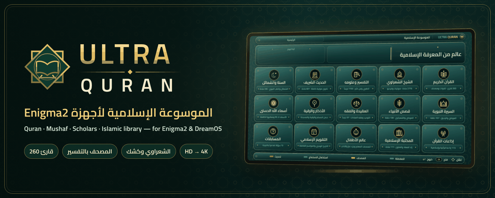
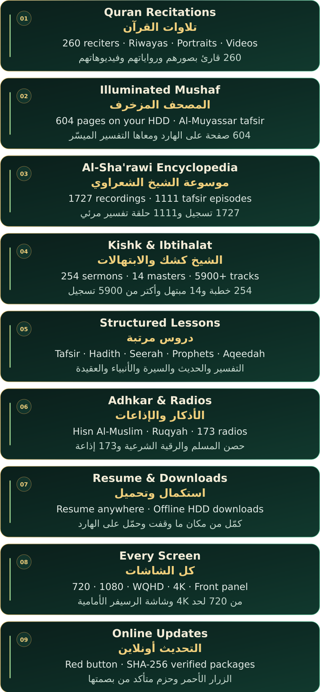
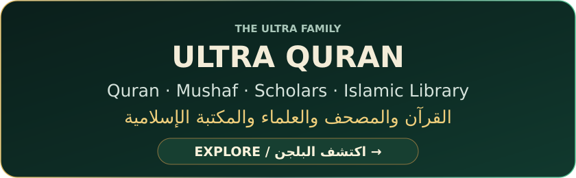
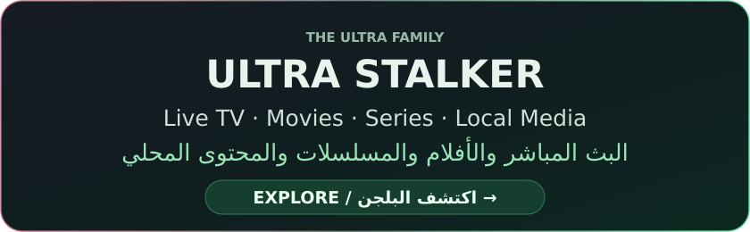
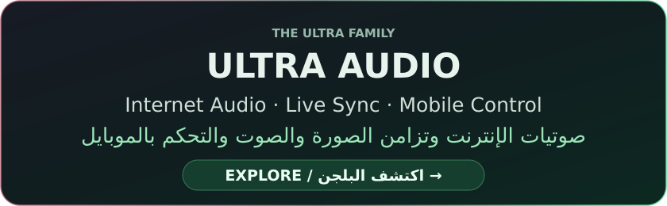

<div align="center">

[](assets/ultraquran-hero.png)

### The Quran, the scholars and the library. On your TV.
### القرآن والعلماء والمكتبة… على شاشة التلفزيون.

260 reciters, an illuminated Mushaf with tafsir, thousands of lessons and sermons, radios and videos — built for Enigma2.

260 قارئ، ومصحف مزخرف بالتفسير، وآلاف الدروس والخطب، وإذاعات وفيديوهات — على أجهزة Enigma2.

[](https://github.com/K3bOra/UltraQuran/releases/latest)
[](#compatibility)
[](#compatibility)
[](https://github.com/K3bOra/UltraQuran/releases)

Platform: Enigma2 (OpenATV · OpenBH · OpenPLi) / DreamOS · Python: 3.x / 2.7 · Screens: HD to 4K.

المنصة: Enigma2 (OpenATV · OpenBH · OpenPLi) والدريم · بايثون: 3.x و2.7 · الشاشات: من HD لحد 4K.

[](#install)
[](https://github.com/K3bOra/UltraQuran/releases)

**[التثبيت الرسمي](#install) · [تحميل الإصدارات الرسمية](https://github.com/K3bOra/UltraQuran/releases)**

[What's new](#whats-new) · [Screenshots](#experience) · [Features](#features) · [Compatibility](#compatibility) · [Install](#install) · [FAQ](#faq)

[الجديد](#whats-new) · [الصور](#experience) · [المميزات](#features) · [التوافق](#compatibility) · [التثبيت](#install) · [الأسئلة الشائعة](#faq)

</div>

---

<a name="overview"></a>

## Meet Ultra Quran
### تعرّف على الترا قرآن

A complete Islamic encyclopedia on your receiver: Quran recitations by 260 reciters, a page-by-page illuminated Mushaf with tafsir, the Sheikh Al-Sha'rawi and Sheikh Kishk encyclopedias, Ibtihalat, structured audio lessons in tafsir, hadith, seerah and aqeedah, adhkar, Quran radios, a calendar and a quiz.

موسوعة إسلامية كاملة على الرسيفر: تلاوات 260 قارئ، ومصحف مزخرف صفحة بصفحة ومعاه التفسير، وموسوعة الشيخ الشعراوي والشيخ كشك، والابتهالات، ودروس صوتية مرتبة في التفسير والحديث والسيرة والعقيدة، والأذكار، وإذاعات القرآن، والتقويم والمسابقات.

Royal Emerald design: deep emerald glass, calm gold, one golden focus and straightforward remote navigation in all fifteen sections.

تصميم «الزمرد الملكي»: زجاج زمردي عميق، ودهبي هادي، ومؤشر ذهبي واحد، وتنقل واضح بالريموت في الأقسام الـ 15 كلها.

> Ultra Quran is a player and an index. Recitations, lessons, radios and videos are streamed from their public sources; the plugin does not host them.
>
> الترا قرآن مشغّل وفهرس. التلاوات والدروس والإذاعات والفيديوهات بتشتغل من مصادرها العامة على الإنترنت، والبلجن مش بيستضيفها.

---

<a name="whats-new"></a>

## What's new — V0.9.3
### الجديد في V0.9.3

- Video player bar: the bars beside the poster now end level with the bottom of the poster at the screen edge, with a tighter gap between the upper panels and the lower bars.<br>شريط مشغّل الفيديو: البارات اللي جنب البوستر نزلت وبقت آخرها على نفس مستوى آخر البوستر عند حافة الشاشة، والمسافة بين القطع اللي فوق والبارين اللي تحت بقت أقل.

[Full release notes and downloads](https://github.com/K3bOra/UltraQuran/releases/latest) · [Version history](CHANGELOG.md)

[تفاصيل الإصدار والتحميل](https://github.com/K3bOra/UltraQuran/releases/latest) · [سجل الإصدارات](CHANGELOG.md)

---

<a name="experience"></a>

## The experience
### جولة داخل البلجن

### Home — Fifteen sections, one screen
#### الرئيسية — 15 قسم في شاشة واحدة

The ayah of the day, continue listening from where you stopped, the Hijri date and every section of the encyclopedia.

آية اليوم، وكمّل الاستماع من مكان ما وقفت، والتاريخ الهجري، وكل أقسام الموسوعة.

[](docs/screenshots/01_home.jpg)

### The Holy Quran — 260 reciters
#### القرآن الكريم — 260 قارئ

Great Egyptian reciters first, then every other reciter, with real portraits, biographies, riwayas and verified videos.

كبار القراء المصريين الأول، وبعدهم باقي القراء، بصورهم الحقيقية وسِيَرهم ورواياتهم وفيديوهاتهم الموثّقة.

| Quran Portal<br>بوابة القرآن | Reciter Gallery<br>مكتبة القرّاء |
|:---:|:---:|
| [](docs/screenshots/02_quran_portal.jpg) | [](docs/screenshots/03_reciters.jpg) |
| **Reciter Page**<br>صفحة القارئ | **Surahs & Player**<br>السور والمشغّل |
| [](docs/screenshots/04_reciter_editions.jpg) | [](docs/screenshots/05_surah_player.jpg) |

### The Mushaf — Royal Emerald frame
#### المصحف الشريف — إطار الزمرد الملكي

All 604 pages, stored permanently on the hard drive, with the Al-Muyassar tafsir of every page beside it.

صفحات المصحف الـ 604 محفوظة على الهارد، وجنب كل صفحة التفسير الميسّر بتاعها.

[](docs/screenshots/06_mushaf.jpg)

### The great scholars
#### موسوعات كبار العلماء

Sheikh Al-Sha'rawi (1727 recordings and 1111 tafsir episodes by surah), Sheikh Kishk (254 sermons) and fourteen masters of Ibtihalat.

الشيخ الشعراوي (1727 تسجيل و1111 حلقة تفسير مرئي مقسّمة بالسور)، والشيخ كشك (254 خطبة)، و14 من كبار المبتهلين.

| Sheikh Al-Sha'rawi<br>الشيخ الشعراوي | Video Player<br>مشغّل الفيديو |
|:---:|:---:|
| [](docs/screenshots/07_shaarawy.jpg) | [](docs/screenshots/10_video_player.jpg) |

<details>
<summary><b>More — Kishk, Ibtihalat & biographies / المزيد — كشك والابتهالات والسِّيَر</b></summary>

**Sheikh Kishk**<br>الشيخ كشك

[](docs/screenshots/08_kishk.jpg)

**Mubtahileen & Ibtihalat**<br>المبتهلين والابتهالات

[](docs/screenshots/09_mubtahileen.jpg)

**Full biography (yellow / INFO)**<br>السيرة الذاتية الكاملة (الأصفر أو INFO)

[](docs/screenshots/11_biography.jpg)

</details>

### The library — Lessons, adhkar and radios
#### المكتبة — الدروس والأذكار والإذاعات

Tafsir, hadith, sunnah, seerah, the prophets, aqeedah and fiqh in folders; the morning and evening adhkar with their full text; 173 Quran radios.

التفسير والحديث والسنة والسيرة وقصص الأنبياء والعقيدة والفقه في فولدرات، وأذكار الصباح والمساء بنصها الكامل، و173 إذاعة قرآنية.

| Audio Library<br>المكتبة الصوتية | Adhkar & Ruqyah<br>الأذكار والرقية |
|:---:|:---:|
| [](docs/screenshots/12_library.jpg) | [](docs/screenshots/13_adhkar.jpg) |

<details>
<summary><b>More — Radios, calendar, quiz & updates / المزيد — الإذاعات والتقويم والمسابقات والتحديث</b></summary>

| Quran Radios<br>إذاعات القرآن | Islamic Calendar<br>التقويم الإسلامي |
|:---:|:---:|
| [](docs/screenshots/14_radio.jpg) | [](docs/screenshots/15_calendar.jpg) |
| **Quiz**<br>المسابقات | **Online Update**<br>التحديث أونلاين |
| [](docs/screenshots/16_quiz.jpg) | [](docs/screenshots/17_update.jpg) |

</details>

---

<a name="features"></a>

## A complete Islamic platform
### منصة إسلامية متكاملة

[](assets/premium-features-quran.svg)

<details>
<summary><b>Full feature descriptions<br>تفاصيل المميزات كاملة</b></summary>

**Quran Recitations**

**تلاوات القرآن**

260 reciters with 256 bundled portraits, several riwayas and sources per reciter, and 2392 verified videos for 101 sheikhs.

260 قارئ ومعاهم 256 صورة جاهزة جوه البلجن، وأكتر من رواية ومصدر للقارئ، و2392 فيديو موثّق لـ 101 شيخ.

**Illuminated Mushaf**

**المصحف المزخرف**

604 pages stored permanently on the hard drive (no USB needed), the Royal Emerald frame and the Al-Muyassar tafsir for every page.

604 صفحة محفوظة على الهارد من غير فلاشة، وإطار الزمرد الملكي، والتفسير الميسّر لكل صفحة.

**Scholar Encyclopedias**

**موسوعات العلماء**

Sheikh Al-Sha'rawi in two folders (audio and video), Sheikh Abdul Hamid Kishk (254 sermons and verified video sermons) and 14 masters of Ibtihalat with 5900+ tracks.

الشيخ الشعراوي في فولدرين (صوتيات وفيديو)، والشيخ عبد الحميد كشك (254 خطبة وخطب مرئية موثّقة)، و14 من كبار المبتهلين بأكتر من 5900 تسجيل.

**Structured Lessons**

**دروس مرتبة**

2500+ audio lessons: tafsir, hadith, shama'il, seerah, the prophets, aqeedah and fiqh, each series in its own folder.

أكتر من 2500 درس صوتي: التفسير والحديث والشمائل والسيرة وقصص الأنبياء والعقيدة والفقه، وكل سلسلة في فولدر لوحدها.

**Adhkar, Ruqyah & Names of Allah**

**الأذكار والرقية والأسماء الحسنى**

Morning and evening adhkar from Hisn Al-Muslim with their full text, the Ruqyah, the interactive tasbeeh and the 99 Names with their meanings.

أذكار الصباح والمساء من حصن المسلم بنصها الكامل، والرقية الشرعية، والمسبحة، وأسماء الله الحسنى الـ 99 ومعانيها.

**Radios**

**الإذاعات**

173 live Quran and Islamic radios.

173 إذاعة قرآنية وإسلامية مباشرة.

**Resume & Downloads**

**استكمال وتحميل**

Every recitation, sermon, lesson or video resumes where you stopped; download a surah, a whole reciter folder or a video to the hard drive for offline listening.

أي تلاوة أو خطبة أو درس أو فيديو بيكمّل من مكان ما وقفت، وتقدر تحمّل سورة أو فولدر قارئ كامل أو فيديو على الهارد وتسمعه من غير نت.

**Every Screen**

**كل الشاشات**

720, 1280, 1920, 2560 (WQHD) and 3840 (4K) layouts, front-panel display support, and a fast start on every image.

مقاسات 720 و1280 و1920 و2560 (WQHD) و3840 (4K)، ودعم شاشة الرسيفر الأمامية، وفتح سريع على كل الصور.

**Online Updates**

**التحديث أونلاين**

The red button on the home screen checks this repository, verifies the package's SHA-256 and installs the right package for your image.

الزرار الأحمر في الرئيسية بيدوّر على تحديث في المستودع ده، ويتأكد من بصمة SHA-256، ويسطّب الحزمة المناسبة لصورة الجهاز.

</details>

<details>
<summary><b>Remote control / أزرار الريموت</b></summary>

| Key<br>الزرار | Action<br>الوظيفة |
|:---|:---|
| Arrows<br>الأسهم | Navigate<br>التنقل |
| OK | Open / play<br>فتح أو تشغيل |
| Red · Green · Yellow · Blue<br>الأحمر · الأخضر · الأصفر · الأزرق | As shown in the bar at the bottom of each screen<br>حسب الشريط اللي تحت في كل شاشة |
| Yellow / INFO<br>الأصفر أو INFO | Full biography<br>السيرة الذاتية الكاملة |
| 1 / 3 · 4 / 6 · 7 / 9 | Back / forward 10 s · 1 min · 5 min<br>ترجيع وتقديم 10 ثواني · دقيقة · 5 دقايق |
| 5 · 2 / 8 | Pause · previous / next<br>إيقاف مؤقت · السابق والتالي |

</details>

---

<a name="compatibility"></a>

## Compatibility
### التوافق والمتطلبات

| Requirement<br>المتطلب | Details<br>التفاصيل |
|:---|:---|
| Platform<br>المنصة | Enigma2: OpenATV · OpenBH · OpenPLi · DreamOS |
| Python<br>بايثون | Open: 3.x · DreamOS: 2.7 |
| Package manager<br>مدير الحزم | Open: `opkg` / IPK · DreamOS: `dpkg` / DEB |
| Screen<br>الشاشة | 720 · 1280 · 1920 · 2560 · 3840 |
| Storage<br>التخزين | About 32 MB in flash; a hard drive or USB is recommended for the Mushaf, portraits and downloads<br>حوالي 32 ميجا على الفلاش، ويُفضّل هارد أو فلاشة للمصحف والصور والتحميلات |
| Recommended<br>يُفضّل | `python3-pil` (Pillow) · `ffmpeg` |
| Access<br>الوصول | Root via Telnet / SSH<br>حساب root عبر Telnet أو SSH |

These are the published package requirements, not confirmation that every receiver and image has been tested.

دي متطلبات الحزمة المنشورة، وليست تأكيدًا إن كل جهاز وصورة تشغيل تم اختبارهم عمليًا.

---

<a name="install"></a>

## Official installation
### التثبيت الرسمي

Open Telnet or SSH on a compatible receiver as **root**, then run:

افتح Telnet أو SSH على رسيفر متوافق بحساب **root**، ثم نفّذ:

```sh
wget -qO- https://raw.githubusercontent.com/K3bOra/UltraQuran/main/install.sh | /bin/sh
```

The same command automatically selects the IPK for OpenATV / OpenBH / OpenPLi or the DEB for DreamOS.

نفس الأمر يختار تلقائيًا IPK لـ OpenATV / OpenBH / OpenPLi أو DEB للدريم.

The installer reads the latest official release and checks the package size, SHA-256, name, version and architecture before installing with `opkg` or `dpkg`. Then restart the Enigma2 GUI and open **Plugins → Ultra Quran**.

المُثبّت يقرأ أحدث إصدار رسمي، ويتحقق من حجم الحزمة وبصمة SHA-256 واسمها ورقمها ومعماريتها قبل التثبيت بـ `opkg` أو `dpkg`. بعدها أعد تشغيل واجهة Enigma2 وافتح **البلجنات ← Ultra Quran**.

[Review the installer](install.sh) · [Download the latest packages](https://github.com/K3bOra/UltraQuran/releases/latest)

[راجع سكربت التثبيت](install.sh) · [حمّل أحدث الحزم](https://github.com/K3bOra/UltraQuran/releases/latest)

> Already installed? Press the **red button** on the plugin's home screen to update online.
>
> البلجن متسطب عندك؟ دوس **الزرار الأحمر** في الرئيسية للتحديث أونلاين.

---

<a name="faq"></a>

## Troubleshooting & FAQ
### حل المشاكل والأسئلة الشائعة

<details>
<summary><b>Installation failed — what should I check?<br>التثبيت فشل — أراجع إيه؟</b></summary>

Check that you are using **root**, the internet connection works and there is about 70 MB free in `/tmp` and 32 MB in flash. Keep the full error output when reporting a problem.

تأكد إنك داخل بحساب **root**، والإنترنت شغال، وفيه حوالي 70 ميجا فاضية في `/tmp` و32 ميجا على الفلاش. احتفظ برسالة الخطأ كاملة لو هتبلغ عن المشكلة.

</details>

<details>
<summary><b>A recitation or video does not play.<br>تلاوة أو فيديو مش بيشتغل.</b></summary>

Content is streamed from public sources and a source can be busy or offline. Try another riwaya or source of the same reciter. You can pick the first player yourself by writing `exteplayer3`, `dreamos` or `gstreamer` in `/etc/enigma2/ultra-quran-player.txt`.

المحتوى بيشتغل من مصادر عامة، وممكن مصدر يكون واقع أو عليه ضغط. جرّب رواية أو مصدر تاني لنفس القارئ. وتقدر تختار المشغّل الأول بنفسك لما تكتب `exteplayer3` أو `dreamos` أو `gstreamer` في ملف `/etc/enigma2/ultra-quran-player.txt`.

</details>

<details>
<summary><b>Where are the Mushaf, portraits and downloads saved?<br>المصحف والصور والتحميلات بتتحفظ فين؟</b></summary>

In an `UltraQuran` folder on the hard drive or USB (`/media/…/UltraQuran`). Without one, a small cache is kept on the receiver.

في فولدر `UltraQuran` على الهارد أو الفلاشة (`/media/…/UltraQuran`). من غيرهم بيتحفظ كاش صغير على الرسيفر.

</details>

<details>
<summary><b>Will an update remove my favorites or resume points?<br>هل التحديث هيمسح المفضلة أو أماكن الاستكمال؟</b></summary>

No. Resume points (`/etc/enigma2/ultra-quran-resume.json`), downloads and biographies are kept across updates.

لأ. أماكن الاستكمال (`/etc/enigma2/ultra-quran-resume.json`) والتحميلات والسِّيَر بتفضل زي ما هي بعد التحديث.

</details>

<details>
<summary><b>How do I report a problem?<br>أبلغ عن مشكلة إزاي؟</b></summary>

[Open an issue](https://github.com/K3bOra/UltraQuran/issues) with the receiver model, image, Python version, plugin version, steps to reproduce and the end of `/tmp/ultra-quran.log`.

[افتح بلاغ مشكلة](https://github.com/K3bOra/UltraQuran/issues)، واكتب موديل الرسيفر واسم الصورة وإصدار بايثون والبلجن وخطوات ظهور المشكلة وآخر سطور ملف `/tmp/ultra-quran.log`.

</details>

---

<a name="ultra-family"></a>

## The Ultra family
### عيلة Ultra

Three plugins. One family. The Quran and the scholars with Ultra Quran, your media with Ultra Stalker, and your commentary and timing with Ultra Audio.

تلات بلجنات من عيلة واحدة: القرآن والعلماء مع الترا قرآن، ومحتواك مع الترا ستالكر، والصوتية والتوقيت مع الترا أوديو.

<p align="center">
<a href="https://github.com/K3bOra/UltraQuran"></a>
</p>

<p align="center">
<a href="https://github.com/K3bOra/UltraStalker"></a>
</p>

<p align="center">
<a href="https://github.com/K3bOra/UltraAudio"></a>
</p>

Each plugin has its own installation command and official updates.

لكل بلجن أمر تثبيت وتحديثات رسمية خاصة به.

---

<a name="resources"></a>

## Updates & resources
### التحديثات والروابط المهمة

The installer reads the manifest attached to the latest official release; the plugin's online update reads the copy in this repository, which is refreshed after every verified release.

المُثبّت بيقرا ملف بيانات أحدث إصدار رسمي، والتحديث أونلاين جوه البلجن بيقرا النسخة اللي في المستودع، واللي بتتحدّث بعد كل إصدار متأكد منه.

- [Official releases](https://github.com/K3bOra/UltraQuran/releases)<br>[الإصدارات الرسمية](https://github.com/K3bOra/UltraQuran/releases)
- [Latest release manifest](https://github.com/K3bOra/UltraQuran/releases/latest/download/update.json)<br>[ملف بيانات أحدث إصدار](https://github.com/K3bOra/UltraQuran/releases/latest/download/update.json)
- [Version history](CHANGELOG.md)<br>[سجل الإصدارات](CHANGELOG.md)
- [Publishing guide](RELEASING.md)<br>[دليل نشر الإصدارات](RELEASING.md)

---

<a name="credits"></a>

## Sources & credits
### المصادر والحقوق

- Recitations, lessons, radios and videos are streamed from their public sources (such as mp3quran, QuranicAudio, islamic.network and the Internet Archive) and remain the property of their owners.<br>التلاوات والدروس والإذاعات والفيديوهات بتشتغل من مصادرها العامة (زي mp3quran وQuranicAudio وislamic.network وأرشيف الإنترنت) وحقوقها لأصحابها.
- Sheikh biographies: Arabic Wikipedia contributors, CC BY-SA 4.0; dates from Wikidata (CC0).<br>سِيَر المشايخ: من ويكيبيديا العربية بترخيص CC BY-SA 4.0، والتواريخ من ويكي بيانات.
- Interface font: Cairo, SIL Open Font License 1.1.<br>خط الواجهة: Cairo بترخيص SIL Open Font License 1.1.
- Audio engine shared with [Ultra Audio](https://github.com/K3bOra/UltraAudio) (MIT).<br>محرك الصوت مشترك مع [الترا أوديو](https://github.com/K3bOra/UltraAudio).

---

## License
### الترخيص

Released under the [MIT License](LICENSE). Third-party material keeps its own license, listed in [LICENSE](LICENSE).

المشروع منشور بترخيص [MIT](LICENSE)، والمواد الخارجية ليها تراخيصها الخاصة والمذكورة في نفس الملف.

---

<div align="center">

**ULTRA QURAN** · Complete Islamic platform for Enigma2

**الترا قرآن** · الموسوعة الإسلامية لأجهزة Enigma2

Developed and maintained by **Ahmed L-HadarY**

تطوير وصيانة **Ahmed L-HadarY**

[GitHub Repository](https://github.com/K3bOra/UltraQuran)<br>
[المستودع الرسمي على GitHub](https://github.com/K3bOra/UltraQuran)

</div>
